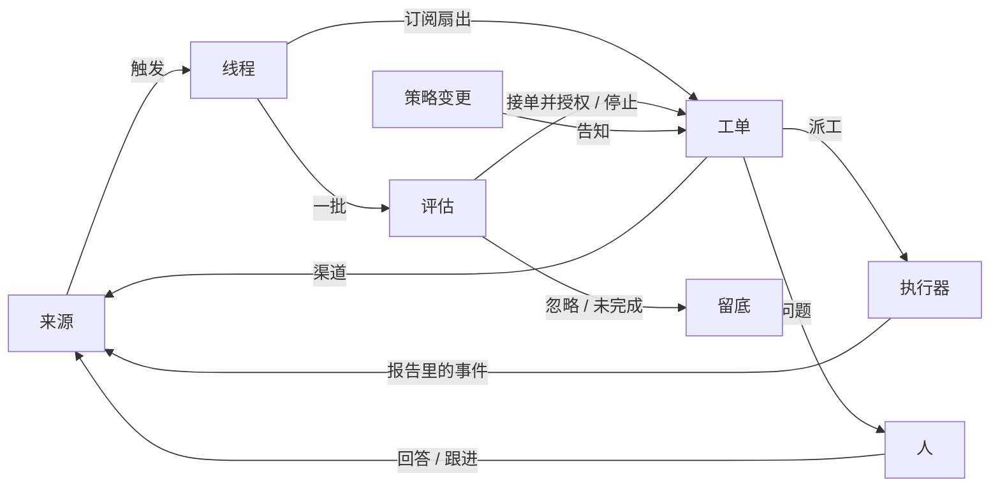

# 001 领域模型

这篇给 superops 的概念起名字，并写下每个概念守的规则。代码、提示词、面板和后面的文档只用这些词。按 [000 理念](000-philosophy.md)，模型里只有工作需要的概念，业务需求变成某个概念的属性。

## 流程

工作从触发到评估再到执行。来源产生触发。触发先作为上下文扇出给订阅了它线程的工单；人的消息这样到了某张工单，就归那张工单，其余的触发进入评估，由评估决定它是不是在要一件新的工作。评估接单时创建带授权的工单；派工把工单交给执行器；结果通过渠道回到来源。

和通用模型相比多出来的一圈是运营流水线的常态：执行器在报告里发出业务事件，事件经流水线来源又成为触发，要么命中下一条规则开出下一张工单，要么通过订阅回到已有的工单。

## 概念

来源、线程、评估、授权、订阅是核心，其余支撑它们。

| 概念 | 定义 | 守的规则 | 为什么存在 |
| --- | --- | --- | --- |
| 来源 | 一种事件流。来源的种类是可复用的实现；来源的实例是一份配置：开没开、收什么 | 自己保存读到哪了。定义什么算一条事件，包括要等一段时间才成立的条件（到点、防抖）。不收的范围在进入领域之前就判掉。把每条触发翻译成它所属的线程和回复用的渠道地址 | 重启不能把事件重放一遍 |
| 触发 | 一条不可变的事件，带来源自己的元数据，例如发送人、事件类型 | 属于一个或多个线程。同一条触发被接单两次只会有一张工单 | 审计和幂等的单位 |
| 线程 | 按时间排列的触发；哪些触发算一个线程由来源定 | 同一时间最多一次评估在它上面进行。可以有多张工单。它持有自己的订阅、进行中的评估和决定的历史 | 给评估一个一致的视图和上下文 |
| 关联 | 一条触发同时属于几个线程时，这些线程之间的关系 | 只增加上下文，从不路由 | 让评估能顺着找到相关的证据 |
| 渠道 | 线程的写入端；地址由来源定 | 一个线程可以有多个渠道；工单持有一组渠道 | 确认、回答、问题、结果都是往外写 |
| 策略 | 带版本的评估规则，加上每个来源自己的部分：谁可以通过这个来源发起工作（用这个来源自己的身份）、准入表、谁能回答问题 | 策略版本覆盖规则、接单模式和各来源的部分。变更影响到某张未结束的工单时（例如它依据的规则改了），告知它的派工，但不撤销授权。不同来源上的身份从不互相映射 | 规则变了，正在进行的评估必须作废 |
| 评估 | 对一批触发的判断，分两层：准入和研判 | 输入：这批触发、线程的快照、线程上的所有工单（含已结束的）、当前策略。输出：一个决定。不存状态 | 决定新工作开始、继续还是停止 |
| 授权 | 一次接单给出的东西：策略版本、范围、强度、命中的规则、发起人在那个来源上的身份、来源是怎么收到这条触发的 | 不可变；要更大的范围就是一张新工单。工单结束不等于授权结束：只有人的停止才撤回它，当前策略不再支持时它失效。已结束的工单恢复之前要按当前策略复核 | 说明这件工作为什么可以做、可以做到哪 |
| 工单 | 一件被授权的工作 | 只有评估能创建。引用它的授权，持有渠道和输入。从未结束到结束；人在它的线程上发消息会把它恢复成未结束，除非它是被人停掉的。状态由它自己定义，不跟着执行器走 | 承载执行和报告 |
| 派工 | 工单和一个执行器实例的绑定 | 一张工单先后可以有多次。待启动 → 执行中 → 已结束，独立于工单。只有它最后的报告能从执行器这一侧结束工单 | 执行器在领域之外，但“谁在执行”必须在领域之内 |
| 订阅 | 工单和线程之间的多对多关系，由线程持有 | 线程上的触发扇出给每张未结束的订阅工单，不看是谁发的；人的消息这样到了工单就不再评估。工单自己产出的事件不回送给它。为了解上下文而关注的线程同样送达，但不带来权限，也不唤醒已结束的工单。已结束的工单保留订阅：人的消息在原授权下恢复它，不评估、不产生决定；机器的事件不唤醒它。被人停掉的工单什么都不收。主 Session 只在消息明确指向某张工单时才把它转过去。人可以取消一个线程上的全部订阅；执行器只能取消自己工单对一个无关线程的订阅，而且不能是工单起点的线程或它跟随的线程 | 后续的讨论和事件能到执行器手里，不用再有人 @ 一次，也不用再写一条路由 |

**人不是领域概念。** 触发带着发送人在那个来源上的标识；名单是来源的策略部分，用那个来源自己的身份（钉钉的 `openDingTalkId` / `userId`，终端的 `operator`）。同一个人在几个来源上各有账号这件事，领域不知道。

**执行器**（连同它的会话和目录）在领域之外，通过派工接进来。

聚合：线程持有订阅、进行中的评估（串行；评估期间到达的触发攒到下一批）和决定的历史。工单持有派工、渠道、输入和当前的问题，按 id 引用决定。

工单上有一个“问题”：执行器在报告里提出、等人回答的那一件事。问题可以带一张卡片（标题、建议、依据、风险、明细、2–4 个选项），选项里写着人选中后才发出的事件。问题和卡片都是工单的属性，不是独立的概念。

## 本项目里的实现

概念和规则是通用的；来源的实现、策略的内容、执行器和渠道属于这一次部署。

### 来源

| 来源 | 产生什么 | 线程怎么划分 | 渠道 |
| --- | --- | --- | --- |
| 定时 `schedule` | `schedules.yaml` 里每一项到点一条触发；机器睡着错过的，醒来补发最近一次 | 每个定时类型一个：`schedule:cron.daily_brief` | 没有可回复的会话 |
| 流水线 `pipeline` | 业务事件 `content.*` / `social.*` / `demand.*` / `gitlab.*` / `lead.*` 等。三处来：确定性脚本通过管理 API 发；执行器在报告里发；人回答问题后宿主按选项发 | 每个业务对象一个，取事件的 `subject`：`pipeline:content:c_20261110_01`、`pipeline:pack:pk_1`、`pipeline:post:<id>`、`pipeline:demand:<id>`、`pipeline:mr:popto/frontend!12`。没有对象的事件按类型归一个线程 | 没有可回复的会话 |
| 终端 `cli` | 操作者用 `superops ask` 对 Agent 说的话 | 每次 `ask` 一个新线程；`superops reply T12` 落在 T12 自己的线程 `ticket:T12` 上 | 本机收件箱 `notify/console.log` |
| 钉钉 `dingtalk` | 运营群里 @兔管家 的消息、带工单编号的回复；`observe: all` 时群里所有消息 | 每条 @ 请求一个新线程：`dingtalk:<群>/<消息 id>`；「T12 …」落在 T12 自己的线程 `ticket:T12` 上 | 那个群 |

定时和流水线是**系统来源**：触发没有发送人。钉钉是会打扰人的来源，发往它的消息要过静默时段和每日卡片上限。

**工单自己的线程。** 接单时每张工单得到一个只属于它的线程 `ticket:T<编号>`，并订阅它。人按编号对工单说的话（钉钉里的「T12 …」、`superops reply T12`、面板上的回复）落在这个线程上，只到这一张工单，不会惊动同一个业务线程上的其他工单。钉钉群没有话题这个结构，“在同一个线程上跟进”就靠它。这是工单的一个属性，不是新概念。

定时线程是共用的：同一个定时类型每次触发开出的工单都订阅 `schedule:<类型>`。所以工单结束时宿主让它退订这个线程，否则每次定时都要把历史上所有的工单读一遍；之后人要找它，走它自己的线程。

目前所有来源的触发都只属于一个线程，所以“关联”在这次部署里没有实例。

### 渠道与 home 渠道

工单的渠道是它起点触发所在的会话：终端的线程，或钉钉的群。定时和流水线起的工单没有会话可回，接单时宿主给它一个 **home 渠道**（`policy.yaml` 的 `home`，正式运行时指到运营群；可以按规则分到别的群）。home 渠道是配置，不是概念：它只是“没有会话的工单在哪里找人”的默认答案。

### 策略、执行器

- 策略：`policy.yaml`（规则、各来源的名单 / 准入表 / 可回答人）叠加数据目录的 `local.yaml`，加上存在库里的接单模式。002 讲。
- 执行器：每张工单一个目录、一段会话；工单命中的规则决定它是由本机的 Agent CLI 跑，还是由确定性脚本跑。003 讲。

## 被否决的概念

前十二行来自原型的设计，后面是本项目从旧系统迁过来时否决的。

| 被否决的 | 原因 |
| --- | --- |
| 把“人”或“成员资格”做成实体，或跨来源映射身份 | 人是触发的元数据；名单是来源的策略部分；跨来源的对应关系是提示词里的一句话 |
| 评估给自己安排延迟的触发 | 要等的条件是一个普通的来源，评估从不反过来依赖来源 |
| 评估的“等待中”“已撤销”状态 | 等待属于来源；评估超时就把触发重新排队，或者以“未完成”结束 |
| 一个线程最多一张未结束的工单 | 一个线程可以承载几件独立的工作；研判靠工单列表避免重复 |
| “追加到工单”这种决定 | 追加就是订阅扇出，不需要评估 |
| 订阅上的准入检查 | 订阅覆盖整个线程；授权把“能做什么”和“看得到什么”分开 |
| 会路由的关联 | 路由靠订阅；关联只增加上下文 |
| 工单状态跟随执行器的会话 | 工单可以交接、恢复、换执行器，所以它定义自己的状态 |
| 执行器宣布“人让我停” | 只有评估能决定一次结束的强度 |
| 策略变更时取消进行中的工单 | 被取消的工作留下半成品；变更只记录并告知 |
| 执行器失败或受阻时锁住它的全部工具 | 暂停自动输入就够了 |
| 从报告的自由文本里推断“在等人” | 分类需要结构化的事实；执行器通过结构化字段提问 |
| 卡片作为独立对象，有自己的编号和生命周期 | 卡片是工单的问题带的属性，编号就是工单号；回答问题是对工单的操作，回答之后同一张工单接着往下走 |
| 任务队列、领取与租约 | 执行器和引擎在同一个进程里；“稍后要做的外部动作”是一条持久化的副作用，不需要有人来领 |
| 采集器作为独立的调度 | 到点是定时来源的一条触发，采集是一条脚本规则的工单；采集到的东西以流水线事件回来 |
| 中台的防抖和分组串行 | 防抖是来源给触发写的“这个时间之前先别评估”；串行是线程本来就守的规则 |
| 返工事件类型（改稿、修复各开一个新任务） | 复核意见、审查意见发在对象自己的线程上，订阅把它送回负责的工单 |
| 把后续事件当作路由指令 | 后续事件就是触发，和别的触发一样过准入和研判 |
| Agent 自己发通知 | Agent 没有发消息的手段；报告里的确认、回答、问题、结果由宿主按规则落到渠道 |
| “已批准”作为 Agent 输出里的一个字段 | 批准是来源记在触发上的凭据，只有人选中的选项才带得上 |
| 审批人作为实体 | 能回答问题的人是来源策略里的名单，和能发起工作的名单一样用来源自己的身份 |

## 术语表

后面的文档会解释这里没展开的词。发给人的消息用大白话，不用这些术语。

| 术语 | 代码里 | 含义 |
| --- | --- | --- |
| 宿主 | host / `Runtime` | superops 进程本身：引擎加上它周围的来源、执行器、发件箱 |
| 主 Session | main Session / router | 研判候选、决定接单 / 转给工单 / 停止 / 忽略的那个角色。每个候选一次独立的模型调用 |
| 执行器 | executor / worker | 执行派工的一方：每张工单一个目录、一段会话 |
| 来源 | Source | 一种事件流：一种实现加一份实例配置 |
| 触发 | Trigger | 来源的一条不可变事件 |
| 线程 | Thread | 按时间排列的触发；评估在它上面一次一个 |
| 关联 | Correlation | 共享同一条触发的线程之间的关系，只增加上下文 |
| 渠道 | Channel | 线程的写入端 |
| 策略 | Policy | 带版本的接单规则，以及每个来源自己的部分 |
| 策略版本 | Policy version | 规则、各来源的策略部分、接单模式这一组合的标识；每份授权都记着它 |
| 评估 | Eval | 把一批触发变成一个决定的过程 |
| 准入 | Gate | 评估确定性的第一层：谁可以发起工作、强度多大 |
| 研判 | Assessment | 评估的第二层：规则直配，或主 Session 的判断 |
| 决定 | Decision | 评估的结果 |
| 授权 | Mandate | 一次接单给出的东西：强度、范围、依据的策略版本 |
| 工单 | Ticket | 一件被授权的工作 |
| 派工 | Assignment | 工单和一个执行器实例的绑定 |
| 订阅 | Subscription | 工单和线程之间的关系 |
| 扇出 | Fan-out | 把订阅线程上的触发作为上下文送到工单 |
| 报告 | Report | 派工向工单报告的状态 |
| 问题 | Attention | 工单上等人回答的那一件事；可以带卡片 |
| 批红 | answer | 有权限的人回答工单的问题：选一个选项 |
| 去向 | Disposition | 一条触发被过滤、评估或扇出的记录 |
| 输入 | Input | 送到工单的上下文：扇出的触发、人的回答、策略变更、恢复、文字 |
| 范围 | Scope | 授权允许做的工作 |
| 强度 | Strength | 授权或评估的依据有多强 |
| 规则 | Rule | 策略里的一条：团队写下的一类可以主动做的工作 |
| 接单模式 | accept mode | `off` / `observe` / `auto` |
| home 渠道 | home | 没有会话的工单找人的地方 |

| 一组取值 | 值 |
| --- | --- |
| 决定 | accept 接单 · stop 停止 · ignore 忽略 · unavailable 未完成 |
| 强度 | explicit 明确 · inferred 推断 |
| 派工 | pending 待启动 · running 执行中 · ended 已结束 |
| 报告 | waiting 等待 · ready 就绪 · blocked 受阻 · failed 失败 · dropped 无需处理 |
| 工单结果 | completed 已完成 · merged 已合并 · closed 已关闭 · dropped 无需处理 · stopped 被人停止 |
