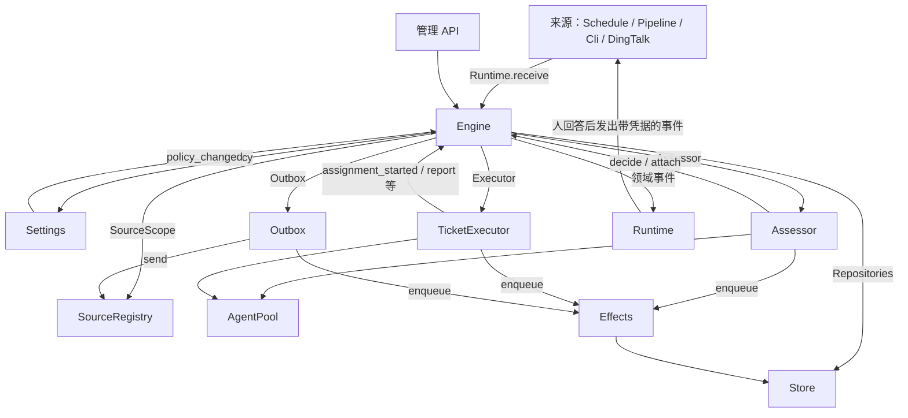

# 007 架构

这篇是给开发者的实现指南：把 [001 领域模型](001-domain.md) 到 [006 部署与运维](006-deployment.md) 里的概念对应到类、接口和文件。先读组合根和引擎，再把模块表和测试表当作代码索引用。

## 核心类与胶水

核心类各自守着一个领域概念或一条外部边界，彼此只通过小接口说话。胶水把 HTTP 请求、命令行参数、来源的原始事件、Agent 的 JSON 输出翻译成对这些类的调用，再把结果翻译成视图、卡片和消息。

### Runtime

`Runtime`（`superops/app/runtime.py`）是组合根，自己不含领域规则。构造时打开 Store，造出 HealthBoard、Effects、SourceRegistry、Settings、AgentPool、Outbox、TicketExecutor、Assessor 和 Engine，再登记四个来源（钉钉来源导入失败就跳过）。执行器和研判方要回调引擎，所以它们拿到的是 Runtime 本身，用到时才取 `rt.engine`。

- `start()`：`Settings.start`（发现策略版本和上次不同就按一次策略变更处理）→ `TicketExecutor.resume`（处理重启前还在跑的派工）→ `Effects.start` → 各来源 `start` → 起 pass 线程。`stop()` 先让执行器取消正在跑的轮（`TicketExecutor.shutdown`），再停来源和副作用队列。
- **一轮 pass**（`run_pass`，每 2 秒，或有人 `kick`）：各来源 `tick` → `Engine.evaluate_due` → 到期处理（问题超时、工单闲置）→ 更新 `evals` 健康项和 Agent 不可用告警。一次只跑一轮。
- `pump()`：同步模式（`Runtime(sync=True)`，测试和 `superops run --once` 用）下反复跑 pass 和副作用，直到没有可做的。同步模式不起任何后台线程。
- 领域事件的消费：`attention.asked` → 渲染问题卡片并通过 `Engine.reply` 发出；`attention.answered` → 发出选项里的事件（带批准凭据）、记决策档案、发回执；`ticket.ended` → 让结束的工单退订共用的定时线程（`Engine.unsubscribe_ticket`）。都在事务提交之后执行。其余领域事件目前没有消费者。
- 人的操作：`find_ticket`（按 `T12` / `12` / id 前缀）、`ticket_thread`（人按编号对工单说话时消息落在哪个线程）、`answer_by_code`（选项解析、只批明细）。
- 两种环境：`agent_dirs` 给 Agent（只有目录）；`script_env` 给确定性脚本（另有任务文件、管理 API 的地址和 `script_token`）。`script_token` 每次启动随机生成，带着它调 `/v1/events` 才算可信方。
- 找人：`home_channel`、`notify_ticket`、`notify`（告警、脚本要说的话、文件），全部走 Outbox。
- `digest`：一段时间的留底摘要，日报和周报的上下文。
- `LocalClient`：进程内的“宿主客户端”，上下文提供者用它取摘要和计数器，不走 HTTP。

### Engine

`Engine`（`superops/core/engine.py`）是触发、线程、决定、工单、派工唯一的写入方。它收到的端口定义在 `superops/core/ports.py`：`Repositories`、取当前 `Policy` 的函数、`SourceScope`、`Assessor`、`Executor`、`Outbox`，以及可选的 `prepare_ticket`、`now`、`emit`。

引擎的方法都是同步的。每个命令在一个事务里改它的聚合；端口在事务内只排队，外部动作在提交之后由适配器去做。不合法的请求抛 `UserError`。

引擎对外是一个入口，内部分五个部分，各继承 `EnginePart`（`superops/core/part.py`），依赖单向：

| 部分 | 负责 | 依赖 |
| --- | --- | --- |
| `Intake` | 来源的触发：存一次并记去向，记线程关联，扇出给订阅的工单（工单自己产出的不回送），没有工单决定它时排到主线程等评估 | Tickets |
| `Evals` | 线程上的评估：成批、从准入取强度和依据、期限与暂停、超时重排、候选、交还、策略变更时重来，以及以什么决定结束 | Tickets |
| `Tickets` | 工单的生命周期：从接单创建（授权、订阅、第一次派工）、跟随线程及其关闭、转入的线程和只作上下文的线程、输入、恢复和被拒绝的恢复、重试、重启、停止和结束、放掉订阅、策略变更的告知 | Replies |
| `Assignments` | 执行器报告的事实：派工开始、输入送达、读取、一轮结束、被重启打断、报告及其问题；以及人对问题的回答 | Tickets、Replies |
| `Replies` | 通过 Outbox 写渠道：确认、回答、结果、问题，各按允许它的规则 | 无 |

命令用祈使命名（`stop_ticket`），适配器报告的事实用过去时（`assignment_started`）。

| 角色 | 方法 | 作用 | 这个项目里谁调用 |
| --- | --- | --- | --- |
| 来源 | `receive(trigger)` | 存一次触发，回答 `stored` / `duplicate` / `filtered`；扇出；人的消息立刻恢复已结束的工单（除非暂停）；排队评估 | `Runtime.receive`（各来源、管理 API 的回复） |
| 来源 | `bind_thread(ticket_id, thread, own)` | 让未结束的工单跟随一个线程；之后是线程的关闭而不是 `ready` 报告结束它 | TicketExecutor 开出 MR 后 |
| 来源 | `thread_closed(thread, outcome, at)` | 线程关了：跟随它的工单在跟完之后以 `merged` / `closed` 结束，除非工作还没做完 | PipelineSource 收到关闭类事件时 |
| 时钟 | `evaluate_due()` | 过期的评估重排（两次后记未完成）；给有排队触发且过了 `holdUntil` 的线程开评估；恢复暂停期间等来了人的消息的已结束工单。暂停时只维护期限 | 每轮 pass |
| 研判方 | `candidate(trigger_id)` | 持有这条触发的评估，研判方看到的样子 | Assessor |
| 研判方 | `candidate_delivered(eval_id)` | 候选到了研判方：期限从现在算 | Assessor |
| 研判方 | `decide(trigger_id, outcome)` | 记录一个决定。接单原子地创建工单、授权、派工、订阅和确认；推断强度的接单要再过一次 `Policy.admits_inferred`；工单还在决定的跟进只允许停止 | Assessor |
| 研判方 | `attach(ticket_id, trigger_id, note?)` | 把明确指向某张工单的触发转给它，结束持有它的评估；已结束的工单在原授权下恢复 | Assessor |
| 研判方 / 人 | `request_status(ticket_id)` | 请一张在等的工单的执行器报告状态 | 管理 API |
| 研判方 / 人 | `note(ticket_id, text)` | 给执行器一条事实，不带来权限 | 管理 API |
| 研判方、执行器 | `reply(request)` | 按用途排一条发往渠道的消息：`acknowledgement` / `answer` / `result` / `attention` | TicketExecutor、Runtime |
| 人 | `answer(ticket_id, option, trigger_id?, by?, reason?, expired?)` | 回答工单当前的问题：查权限（带消息时）、记下选择、清掉问题、把结果作为输入交给执行器、发 `attention.answered` | `Runtime.answer_by_code`、到期处理 |
| 人 | `stop_ticket(ticket_id, reason?)` | 人的停止，撤回授权 | 管理 API |
| 人 | `retry_ticket(ticket_id)` | 结束卡住的派工，开一次新的 | 管理 API |
| 人 | `reevaluate(trigger_id)` | 把一条存着的触发重新排队评估 | 管理 API |
| 人 | `dismiss(decision_id)` | 不再把一条未完成的决定当作问题 | 管理 API |
| 人 | `unsubscribe(thread)` | 取消一个线程上的全部订阅 | 管理 API |
| 宿主 | `unsubscribe_ticket(ticket_id, thread, reason?)` | 让一张工单不再订阅某个线程 | Runtime：工单结束时退订共用的定时线程 |
| 宿主 | `drop_ticket(ticket_id, reason)` | 闲置超期：安静结束，人之后的消息仍会恢复它 | Runtime 的到期处理 |
| 执行器 | `assignment_started(ticket_id, assignment_id)` | 派工开始；等待的输入交出去 | TicketExecutor |
| 执行器 | `inputs_delivered(…)`、`inputs_read(…)` | 输入到了执行器、被这一轮读到了。读过的输入在工单结束时不再放掉 | TicketExecutor，在一轮确实跑了之后 |
| 执行器 | `turn_ended(ticket_id, assignment_id)` | 一轮结束 | TicketExecutor |
| 执行器 | `report(ticket_id, report)` | 记录报告和它的问题；`dropped` 结束工单，`ready` 结束不跟随线程的工单 | TicketExecutor |
| 执行器 | `handback(ticket_id, trigger_id, reason)` | 交还一条到过它的触发；没有别的工单决定时排队评估 | TicketExecutor（报告的 `handback`） |
| 执行器 | `mark_unrelated(ticket_id, thread, reason)` | 取消自己对一个转入线程的订阅，并交还那里的跟进 | TicketExecutor（报告的 `unrelated`） |
| 执行器 | `follow_for_context(ticket_id, thread)` | 为了解上下文订阅一个线程 | TicketExecutor（报告的 `follow`） |
| 执行器 | `assignment_interrupted(ticket_id, assignment_id)` | 宿主重启时还在跑的派工：该重来的带恢复说明重来 | `TicketExecutor.resume` |
| 执行器 | `delivery_failed(…)` | 输入送达失败 | 目前没有调用方 |
| 设置 | `policy_changed(from, to, effects)` | 告知受影响的未结束工单，进行中的评估在新版本下重来 | Settings |

几个共用的判断让这些规则保持一致：`waits_for_person`（最近的报告是受阻或失败，之后没有人的消息）、`followup_owners`（哪些工单的执行器还在决定一条人的跟进）、`settled`（一个决定是否了结了请求）在 `superops/core/model.py`；`ticket_stage`、`can_retry` 在 `superops/core/stage.py`。

领域事件（`DOMAIN_EVENTS`，`superops/core/ports.py`）：`trigger.received`、`eval.started`、`decision.recorded`、`ticket.created`、`ticket.resumed`、`ticket.ended`、`assignment.started`、`assignment.ended`、`thread.subscribed`、`thread.unsubscribed`、`trigger.requeued`、`trigger.followup`、`policy.changed`、`attention.asked`、`attention.answered`。

### 模型

聚合都是可以直接存成 JSON 的 dict，键名沿用原型的驼峰写法，方便两边对照。形状写在 `superops/core/model.py` 的文档串里。原因（决定为什么这样、触发为什么被过滤）是原因码加取值，`superops/core/reasons.py` 的 `REASONS` 给出中文模板；人或 Agent 能引发的拒绝是 `superops/core/errors.py` 的 `UserError(code, values)`。

相对原型多出来的都是已有概念的属性：

- `Trigger.notBefore`：来源声明“这个时间之前先别评估”，引擎记成线程的 `holdUntil`。防抖属于来源。
- `Trigger.byTicket`：这条事件是哪张工单产出的，扇出时不回送给它。
- `Attention.card`、`Attention.expiresAt`、`Ticket.answered`，以及 `Engine.answer`、`Policy.may_answer`：批红。
- `Ticket.thread`：工单自己的线程 `ticket:T12`，接单时由 `prepare_ticket` 写上，`Tickets.create` 订阅它。人按编号说的话落在这里，只到这一张工单。
- `Ticket.no`：给人用的短编号，接单时由 `prepare_ticket` 写上。
- `Engine.drop_ticket`：闲置超期。`Engine.unsubscribe_ticket`：宿主替一张工单退订。

### Policy 与 Settings

`superops/app/settings.py` 定义设置的形状和授权规则。

- `normalize(raw)` 把 `policy.yaml`（已合并 `local.yaml`）补全成固定形状，`normalize_rule` 校验每条规则。
- `policy_version(settings)`：规则（影响“能不能开工”的字段）、接单模式和各来源策略部分的哈希。
- `SettingsPolicy` 是引擎的 Policy 端口，每次用都从当前设置现做一个：`gate(trigger, thread, tickets)` 给出是否准入、强度和依据（带批准凭据的流水线事件是明确，依据 `via: approved`）；`revalidate(mandate)` 复核授权；`admits_inferred(rules)` 只在 `auto` 模式且规则都启用时为真；`may_answer(trigger, ticket)` 判断批红权限。
- `rule_matches` / `matching_rules`：事件对 `when` 的匹配，Assessor 和 PipelineSource 都用。
- `policy_effects(tickets, old, now, sources)`：一次变更影响哪些未结束的工单、怎么影响。
- `Settings`：读文件、叠加库里的运行时开关（`settings-overrides`）、`reload`、`set_mode`、`pause`（全部或 `rule:` / `agent:` / `origin:` 键）、`history`。版本变了就记一条历史并调 `Engine.policy_changed`。

### Assessor

`Assessor`（`superops/app/assessor.py`）是引擎的研判端口。`request` 排一条 `assessment` 副作用；处理时先 `candidate_delivered`，再走两条路之一：

- `direct(candidate)`：确定性的结果（规则直配及其各项检查），或返回 `None` 表示需要模型。批里有带批准凭据的事件时，即使强度是明确也走这条路，而且不看接单模式。
- `semantic_rules(settings)`：需要主 Session 研判的规则，即启用、没有 `when`、没被单独暂停的；提示词的策略一节和 `_inferred` 的核对用同一个集合。
- `route(candidate)`：拼主 Session 的提示词，经 AgentPool 按 `eval.role`（`route`）的降级链和这个角色的模型配置跑一次只读的调用，输出按 `ROUTE_SCHEMA` 校验；`apply` 把决定落到引擎上，推断候选的接单先过 `_inferred` 的核对。调用失败或决定被引擎拒绝记为未完成。

### 执行器

`TicketExecutor`（`superops/executor/worker.py`）是引擎的 Executor 端口：`start`、`deliver` 只排 `launch`、`delivery` 副作用；`stop` 在提交后取消还没启动的派工并给正在跑的那一轮发取消信号。`shutdown` 在宿主停止时取消所有正在跑的轮。`prepare` 是引擎的 `prepare_ticket` 钩子：给工单编号、短名、目录和它自己的线程，没有会话的工单配上 home 渠道。落地报告时，Agent 写的事件去掉所有以 `_` 开头的键、以不可信身份发出；宿主自己要发的事件（推送后的 MR 事件、入库程序追加的事件）走单独的列表，以可信身份发出。一轮的步骤和报告的落地（`_agent_turn`、`_script_turn`、`_apply`、`_tell`）见 003。

`AgentPool`（`superops/executor/pool.py`）管本机的 Agent：各自的熔断状态（存在 kv 的 `agent:<名>`）、并发、按角色的降级链（含用量策略和排除项）、忙时顺延的等待，以及 `run`：按链找一个 Agent，现拼提示词，调适配器，按 Schema 和额外检查校验，不合格重试一次，记一条运行记录。链上还有没试过的 Agent 时抛 `Later`，让这一轮排队；调用方传入的 `tried` 列表记着这一轮已经失败过的 Agent，工单执行器把它存在 kv 里，排队重来时不再拉起它们。

`superops/executor/adapters.py` 是各 Agent 的非交互调用：Claude、Codex、Antigravity 各一个适配器，另有收发件箱（WorkBuddy）、确定性脚本、通用命令（测试用）。工具档位在这里翻译成各家的权限参数。`superops/executor/breaker.py` 按错误输出归类。

### Effects

`Effects`（`superops/app/effects.py`）是持久化的副作用队列。命令在自己的事务里 `enqueue(kind, key, payload)`，提交之后才开始执行。每个 `(kind, key)` 一行：等待中的同一个 key 再入队会替换载荷并立刻到期，不改变排队位置。失败按指数退避重试；抛 `Later` 表示“现在做不了”，不计失败。

| kind | 处理方 | 做什么 | 同时最多 | 重试 |
| --- | --- | --- | --- | --- |
| `assessment` | Assessor | 研判一次评估的候选并作决定 | 4；暂停时 0 | 2 秒翻倍到 60 秒 |
| `launch` | TicketExecutor | 启动一次待启动的派工：等前置规则、建目录、`assignment_started` | `max_workers`；暂停时 0 | 5 秒翻倍到 300 秒 |
| `delivery` | TicketExecutor | 跑一轮：把工单等待的输入交给它运行中的派工 | `max_workers` + 1；暂停时 0。轮次本身还受执行位限制 | 2 秒翻倍到 60 秒 |
| `reply` | Outbox | 通过来源把消息发到渠道 | 1；暂停时 0 | 5 秒翻倍到 300 秒 |

每个 kind 在健康板上有一项 `effect:<kind>`，同类里有一项连续失败 3 次才报错；`launch` 和 `delivery` 不报（它们的失败成为工单的报告）。每个 kind 的调度单独兜住：某一类的调度自身出错记在它的健康项上，不拖住别的种类。原型里把报告和跟进转给主 Session 的 `relay`、`notice` 两类这里没有：主 Session 不是常驻会话。

### Outbox

`Outbox`（`superops/app/outbox.py`）是引擎的 Outbox 端口，也是唯一写回执的地方。`send` 在一个事务里留回执并排 `reply` 副作用；`deliver` 发送前依次检查：同一工单发往同一会话的更早消息是否还没发出、来源是否开着、（会打扰人的来源）静默时段、每日卡片上限；然后 `SourceRegistry.send`。结果 `sent`，或以 `channelGone` / `channelIgnored` 记为丢弃。`withdraw` 撤回还没发出的消息。`notice` 是宿主自己要说的话的入口。

### Sources

`SourceKind`（`superops/sources/kind.py`）是来源的协议：`id`、`title`、`system`（事件没有发送人）、`interrupts`（渠道会打扰人），以及 `scope(meta)`、`send(message)`、`tick()`、`start()`、`stop()`、`config()`、`report(state, detail)`。来源拿到的 `host` 是 Runtime。

`SourceRegistry` 登记来源、判断开没开，并且是引擎的 `SourceScope`：来源关着时一律 `source_off`，否则问来源自己。发件箱通过它 `send`；每轮 pass 通过它 `tick` 所有开着的来源，来源抛出的异常成为它的健康项。

四个来源的实现见 001 的来源表。几处实现上的要点：

- `PipelineSource.emit` 是业务事件进入领域的唯一入口：它算出触发 id（有 `dedup_key` 就由它导出）、线程（`subject`）、是否缺批准凭据（`meta.unapproved`，随后被 `scope` 判为不收）、防抖（匹配规则里最长的 `debounce` 写成 `notBefore`）；收下之后如果事件类型在关闭表里，再调 `Engine.thread_closed`。`decision.made`、`decision.note`、`agent.unavailable` 三种内部事件不进领域，直接处理。
- `DingTalkSource.handle` 把一条 `dws` 原始事件交给 `superops/biz/notifier/listener.py` 的 `classify_event` 解析并判断权限，再按结果分流：指令确定性处理；带 `T` 编号的回复落到那张工单自己的线程上（`Runtime.ticket_thread`），是选项就同时批红；`C` 开头的编号不理会，留给旧 ops；其余 @ 的消息成为新线程上的触发。
- `ScheduleSource.tick` 对每个定时项算“最近一次应触发的时刻”，和 kv 里记的不同就触发；错过超过 `max_late` 的只记不发。

### 胶水

| 胶水 | 翻译什么 |
| --- | --- |
| `superops/app/runtime.py` | 组合根；领域事件 → 卡片、已批准的事件、回执 |
| `superops/app/prompts.py` | 工单、触发、输入、规则 → 提示词；工单的问题 → 发给人的卡片文字 |
| `superops/app/http.py`、`superops/app/views.py` | HTTP 请求 → 调用；Store 的读取 → 面板和命令行的视图 |
| `superops/cli.py` | 命令行参数 → 管理 API 的请求 |
| `superops/executor/worker.py` | Agent 和脚本的 JSON 输出 → 引擎的调用；工单 → 脚本认识的任务文件 |
| `superops/sources/*.py` | 定时表、业务事件、终端输入、钉钉事件 → 触发；消息 → 写到渠道 |

## 依赖规则

- **核心不依赖核心之外。** `superops/core` 只导入标准库和自己，不做 I/O。时间、仓库、策略、研判、执行、发件箱都从端口进来。
- **来源不决定工作。** `superops/sources` 只把事件翻译成触发、把消息写到渠道；它读设置里的规则只为两件来源自己的事（缺批准凭据的不收、防抖），不创建工单。
- **业务模块不知道领域。** `superops/biz` 不导入 `superops/core`、`superops/app`、`superops/executor`、`superops/sources`；确定性脚本通过 `/v1/*` 和宿主说话。
- **基础设施不知道业务。** `superops/infra` 只导入标准库、第三方库和自己，不导入 `superops/biz`，也不出现平台、内容、线索这类业务名词。各层要用的路径、时间、配置、校验、打码、决策档案、钥匙串、钉钉 / 飞书渠道都从这里取，不从 `biz` 取。
- **部署名只有一个出处。** 数据目录、钥匙串服务名、launchd 标签、积分计数器名一律问 `superops/infra/instance.py`，代码里不写 `popto` 这类部署名；`instance` 只从仓库的 `agents.yaml` 读（`local.yaml` 本身放在数据目录里）。
- **还没拆干净的地方。** 下面这些仍是应用层、执行层、来源直接用 Popto 的业务模块，留待拆成业务包的扩展点；新代码不要再加这类依赖：
  - `app/publishing.py`、`app/http.py` 的内容和账号接口、`app/preflight.py` 的登录与密钥检查，用 `biz/executors/publishers`、`biz/db`、`biz/bizviews`、`biz/contents`、`biz/agent_browser`；
  - `executor/worker.py` 的上下文、入库、视频抽帧、图文出图、CI worktree，用 `biz/context`、`biz/ingest`、`biz/video_prep`、`biz/render_pages`、`biz/ci`；
  - `sources/dingtalk.py` 的群聊指令解析用 `biz/notifier/listener.py`，`sources/schedule.py` 用 `biz/scheduler.py`；
  - `cli.py` 的业务子命令（发布、采集、浏览器、保留期）和 `superops check` 用到的 `biz/context.CONTEXT_PROVIDERS`；
  - `app/runtime.py` 认的事件类型 `popto.feedback.new`，`app/prompts.py` 的来源名 `popto`，`prompts/shared.md` 开头的业务描述。
- **一种状态一个写入方。**

  | 状态 | 写入方 |
  | --- | --- |
  | 触发、去向、线程、决定、工单、派工 | Engine |
  | 设置的运行时开关、策略版本及其历史 | Settings |
  | 副作用队列 | Effects |
  | 发件箱回执 | Outbox |
  | 运行记录、Agent 熔断状态 | AgentPool（脚本的运行记录由 TicketExecutor 写） |
  | 工单的会话 ID、轮数、一轮里试过的 Agent | TicketExecutor |
  | 定时的上次触发时刻 | ScheduleSource |
  | 计数器 | Runtime（来自报告的 `credits_used` 和 `/v1/counter`） |
  | 健康项 | 各自的部件：`runtime`、`evals` 是 Runtime，`effect:<kind>` 是 Effects，`source:<id>` 是那个来源，`agent:<名>` 是 AgentPool |
  | `ops.db` | 业务模块：采集器、执行器脚本、入库程序 |
  | `decisions.md` / `not-doing.md` | `superops/infra/governance.py`，只追加 |

- **请求和事实。** 请求可以被拒绝，用祈使命名；记录适配器做了什么的方法用过去时。
- **固定的拒绝。** 能被人或 Agent 引发的拒绝都是 `USER_ERRORS` 里的码；管理 API 对 `missing` 类回 404，其余回 400。

## 模块

| 路径 | 职责 |
| --- | --- |
| `superops/core/__init__.py` | 核心的导出 |
| `superops/core/model.py` | 聚合的形状；时间工具；`thread_key`、`live_ticket`、`latest_report`、`read_until`、`waits_for_person`、`reached`、`followup_owners`、`settled` |
| `superops/core/ports.py` | 端口：`SourceScope`、`Policy`、`Assessor`、`Executor`、`Outbox`、`Repositories`，以及领域事件表 |
| `superops/core/engine.py` | `Engine`：核心唯一的入口，每个命令一个事务 |
| `superops/core/part.py` | `EnginePart`（各部分的基类：交还、接下、排队评估、取线程）和 `EngineOptions` |
| `superops/core/intake.py` | `Intake`：来源的触发 → 去向、扇出、排队评估 |
| `superops/core/evals.py` | `Evals`：线程上的评估和它们的决定 |
| `superops/core/tickets.py` | `Tickets`：工单的生命周期、跟随的线程、订阅、输入 |
| `superops/core/assignments.py` | `Assignments`：执行器报告的事实、报告、人对问题的回答 |
| `superops/core/replies.py` | `Replies`：引擎发往渠道的消息 |
| `superops/core/stage.py` | `ticket_stage`、`can_retry` |
| `superops/core/errors.py` | `UserError`、`USER_ERRORS` |
| `superops/core/reasons.py` | 原因码和模板，`key`（由内容导出的稳定标识），`reason_text` |
| `superops/core/memory.py` | `MemoryRepositories`：内存里的仓库，顺序和回滚与 Store 一致，给领域测试用 |
| `superops/app/runtime.py` | `Runtime`（组合根）和 `LocalClient` |
| `superops/app/store.py` | `Store`：唯一打开 `superops.sqlite` 的地方 |
| `superops/app/effects.py` | `Effects`、`Later` |
| `superops/app/outbox.py` | `Outbox`、静默时段的计算 |
| `superops/app/settings.py` | 设置的形状、规则匹配、策略版本、`SettingsPolicy`、`policy_effects`、`Settings` |
| `superops/app/assessor.py` | `Assessor`：规则直配和主 Session 研判 |
| `superops/app/prompts.py` | 提示词拼装，`REPORT_SCHEMA` / `ROUTE_SCHEMA` 和对应的字段说明，问题卡片的渲染 |
| `superops/app/views.py` | 面板和命令行读的只读视图 |
| `superops/app/http.py` | 管理 API：`/api/*`、`/v1/*`、面板页面；令牌和同源检查 |
| `superops/app/health.py` | `HealthBoard` |
| `superops/app/publishing.py` | 面板的发布台：每个号（专用 Chrome 登录目录，同一平台可以多个）的状态和读到的昵称 / 账号 ID / 粉丝数 / 头像；添加账号、设为默认、同一个号登两次的提醒、发布包换账号；校验账号、网页扫码登录、开窗口登录、打开草稿箱、预演、重试放到子进程里跑（同一个号同时只跑一个，发布包的动作占住它要发的号，扫码可中途取消）；扫码状态、二维码和头像、短信验证码转交；退出登录（登录目录挪到回收处，清掉头像和扫码状态）；发布包详情和只给发布包目录里媒体文件的下载口 |
| `superops/app/preflight.py` | 启动检查：有规则用得到的登录态（创作者后台、专用浏览器）、钥匙串密钥、本机命令是否准备好；`run` 出结果，`render` 写成给人看的消息，`fingerprint` 让同样的缺口一天只提醒一次 |
| `superops/app/chat.py` | 面板“设置 → 聊天渠道”：钉钉 / 飞书二选一的切换（切完宿主自己重启）、改群（群 ID 或群名）、增删审批人；存成运行时覆盖 |
| `superops/app/skills.py` | 面板“Skill”页：列出仓库和外部目录的 Skill（被哪些规则用、近 30 天工单数和失败数）；看 SKILL.md / schema.json / 文件；在面板上改仓库 Skill 的 SKILL.md（校验 name / description、防覆盖、保存前存一份进数据目录 `skill-history/`），能恢复历史版本；外部目录只读 |
| `superops/app/autoreply.py` | 钉钉自动回复：别人单聊我、或在运营群以外的群里 @我 时，Agent（只读）起草一段回复以我的身份发出；面板开关 auto / off、过滤群（群 ID 优先、群名兜底）、同一条只回一次、每会话每小时 / 每天限量、要本人拿主意的转告 home 渠道；不进工单 |
| `superops/app/chatcheck.py` | 聊天软件准备好了没有：`dws` / `lark-cli` 装没装、本人身份登录状态（doctor、启动检查、面板共用）、群（飞书群名能不能换成群 ID）、home、审批人；`superops doctor` 的聊天几行；飞书本人身份要有的权限（`LARK_SCOPES`） |
| `superops/sources/kind.py` | `SourceKind` 协议和 `SourceRegistry` |
| `superops/sources/schedule.py` | `ScheduleSource` |
| `superops/sources/pipeline.py` | `PipelineSource`：业务事件、批准守门、防抖、线程关闭 |
| `superops/sources/cli.py` | `CliSource`：终端里的请求，本机收件箱 |
| `superops/sources/lark.py` | `LarkSource`（继承钉钉来源的指令处理；和钉钉二选一，由 `settings.normalize` 把关）：以本人身份轮询飞书运营群和单聊 / @我，发消息记 ID 防回声；群可以写群名，第一次用到时换成群 ID |
| `superops/sources/dingtalk.py` | `DingTalkSource`：运营群的消息长连接 + 轮询兜底、卡片回调；另起两条 `dws event +listen-im`（`all-direct` 全部单聊、`at-me` 任何群里 @我），交给 `autoreply.py`（运营群里的 @我 不交） |
| `superops/executor/worker.py` | `TicketExecutor`：一轮怎么跑、报告怎么落地 |
| `superops/executor/pool.py` | `AgentPool`、`Outcome`、`agent_env` |
| `superops/executor/adapters.py` | 找 Agent 命令（`find_command`：装没装看命令本身，包装脚本可有可无）、各 Agent 的命令行调用、工具档位、`run_process`（超时、无动作提前结束、租约丢失时整组杀掉）、从输出里挑出报告；Codex 续接（`exec resume`，直调 `strict_bin`，续不上新开一次） |
| `superops/executor/breaker.py` | 错误归类、解析恢复时间 |
| `superops/cli.py` | `superops` 的全部子命令，`check`（配置校验） |
| `superops/infra/paths.py` | 代码仓库（`code_root`）、配置目录（`ops_home`，即 `SUPEROPS_HOME`）与数据目录 |
| `superops/infra/config.py` | 读 `agents.yaml`（叠加 `local.yaml`）和 `schedules.yaml`，找 Skill 目录，通知方式 / 工具档位 / 思考强度的取值范围 |
| `superops/infra/instance.py` | `agents.yaml` 的 `instance`：部署名，以及由它推出的数据目录、钥匙串服务名、launchd 标签、积分计数器名；只读仓库里的 `agents.yaml` |
| `superops/infra/timeutil.py` | 上海时区的时间、时长解析、静默窗口 |
| `superops/infra/ids.py` | 业务对象的 id |
| `superops/infra/governance.py` | 决策档案：追加条目、按关键词找相关条目 |
| `superops/infra/validate.py` | 卡片和公共输出的 Schema、Skill Schema 的合并、从文本里取 JSON |
| `superops/infra/redact.py` | 打码：文本、JSON、目录 |
| `superops/infra/secrets.py` | 读钥匙串里的密钥（`keychain`） |
| `superops/infra/notifier/__init__.py` | 发钉钉 / 飞书 / 本地文件的通知器；钉钉来源的渠道用其中的 `DingTalkNotifier` |
| `superops/infra/notifier/lark.py` | 飞书 lark-cli 的封装（本人身份）：拉群消息、搜单聊 / @我、发 Markdown / 文件、引用回复、登录状态；字段整理成和钉钉一样的形状 |
| `superops/biz/platforms.py` | 平台代码和中文名的归一 |
| `superops/biz/db.py` | `ops.db` 的表结构和连接 |
| `superops/biz/client.py` | `HubClient`：脚本回调宿主的 HTTP 客户端 |
| `superops/biz/scriptkit.py` | 脚本共用：读任务、宿主客户端、输出结果 |
| `superops/biz/scheduler.py` | 定时项 → 最近一次 / 下一次应触发的时刻 |
| `superops/biz/context.py` | `ContextBuilder`（上下文提供者）和提供者的名字表 `CONTEXT_PROVIDERS`、不可信内容的隔离区、Skill 正文的读取、脚本路径的解析 |
| `superops/biz/ingest.py` | Agent 的结构化产出 → `ops.db`，按 Skill 分 |
| `superops/biz/contents.py` | 内容的公共小工具：计划日（面板挪过的 planned_date，否则按内容 ID 里的日期）、稿子在哪是图文还是视频、能走自动出图的稿子；日历、今日发布推荐和 `/api/contents` 共用 |
| `superops/biz/render_pages.py` | 图文出图的渲染工具（Agent 环境里的 `$OPS_RENDER`）：一组 HTML 页面用本机 Chrome 无界面、断网截成固定尺寸的 PNG（默认 1080×1440），报出没加载出来的图片 |
| `superops/biz/retention.py` | 数据保留期清理、日志轮转、补打码 |
| `superops/biz/bizviews.py` | 业务统计（面板的业务页）、决策档案的条目 |
| `superops/biz/agent_browser.py` | Agent 专用浏览器 `ops-browser`：包装、拦截、登录 |
| `superops/biz/video_prep.py` | 视频抽帧拼宫格和转写：视频工作落到不能直接看视频的 Agent 时用 |
| `superops/biz/notifier/listener.py` | 钉钉事件的解析和权限判断（`classify_event`）、`dws` 事件流和群消息轮询的循环 |
| `superops/biz/notifier/render.py` | 旧的卡片渲染（Markdown） |
| `superops/biz/collectors/__init__.py` | 采集器包 |
| `superops/biz/collectors/competitors.py` | 竞品数据采集：按竞品词搜抖音、小红书讨论最多的作品（`competitor_works`）、拉用户评论（`competitor_comments`，带所在作品的平台、作者、标题、链接）、采竞品账号（`competitor_accounts`），发 `competitor.comments.batch`（需求评审）和到期的 `competitor.data.ready`（竞品调研） |
| `superops/biz/collectors/listening.py` | 社媒监听（接口优先）：按在用的意图词用 TikHub 搜抖音、小红书、视频号、快手近 24 小时作品，统一字段入 `mentions`；人群词在抖音按粉丝区间找人取最近作品；小红书作者补查粉丝数；算各词命中，发 `social.mention.new` 交给 Agent 判断线索 |
| `superops/biz/collectors/metrics.py` | 发布后排定采集、到点快照、手动采集（`now`，存“手动”快照）、标记作品已删除（`removed`）、异常检测、CSV 导入 |
| `superops/biz/collectors/creator.py` | 读抖音 / 视频号 / 小红书创作者后台的作品数据，按标题对上作品 |
| `superops/biz/collectors/comments.py` | 评论采集 |
| `superops/biz/collectors/funnel.py` | 渠道归因漏斗导入 |
| `superops/biz/collectors/tikhub.py` | TikHub 客户端 |
| `superops/biz/executors/__init__.py` | `ActionLedger`：只执行已批准、未过期的动作，按动作 id 幂等 |
| `superops/biz/executors/publish.py` | 发布包登记、今晚发布卡片、执行发布、人工发布后补登记 |
| `superops/biz/executors/publishers/__init__.py` | 创作者后台自动发布的公共部分：账号键（主号就是平台名，后加的号 `douyin@2`；`platform_of`、`account_keys`）和账号登记 `browser-profiles/accounts.json`（含各平台默认账号 `_defaults`）、发布包发到哪个号（`pack_account`：面板改的 > meta 写的 > 默认账号，认不出来抛 `AccountError` 转人工）、按账号的登录态和锁、试运行、存草稿（`save_draft`）、等大视频传完（`wait_uploaded`）、发布时间（`publish_time`）、草稿在哪（`DRAFTS`、`open_drafts`）、身份验证（`NeedsVerification`） |
| `superops/biz/executors/publishers/qrlogin.py` | 网页里扫码登录（参照 Easel），七个平台（能发布的三个 + 只管账号的快手、B站、知乎、公众号，见 `publishers.ACCOUNTS`）：无界面打开登录页，找码截图（抖音按尺寸找方形码、小红书创作平台登录框、视频号截跨域扫码 iframe），过期点刷新、几秒重截一次，判断已扫码；抖音短信验证（选接收短信、获取验证码、等面板填码、填进去提交、码错让人重输）；状态按账号键写进 `publish-login/<账号键>.json`；登录成功和校验账号时读昵称、头像、账号 ID、粉丝数（抖音和小红书的账号接口、视频号 auth_data 响应、B站 nav、知乎 /api/v4/me、快手和公众号的后台页面）；只管账号的平台登没登录问各自的账号接口（快手 current/user、B站 nav、知乎 me），公众号看后台网址里的 token，头像下载到本地 |
| `superops/biz/executors/publishers/__main__.py` | 发布前的登录检查 |
| `superops/biz/executors/publishers/douyin.py` | 抖音发布：先等视频传完再设竖 / 横封面、跳到作品管理页后等后台上传完、短信验证、存草稿（只有一个暂存位，被占就不覆盖） |
| `superops/biz/executors/publishers/channels.py` | 视频号发布：转 H.264、等上传完再点发表、表单里声明原创、保存草稿 |
| `superops/biz/executors/publishers/xiaohongshu.py` | 小红书发布：视频笔记和图文笔记（切“上传图文”页签、被引导弹层挡住先移掉、按页序逐张传图等预览，最多 18 张）、封闭 shadow DOM 里的发布 / 暂存离开按钮按坐标点、扫码验证 |
| `superops/biz/executors/reply.py` | 已批准的评论回复 |
| `superops/biz/executors/leads.py` | 线索卡片（跟进并发评论 / 只记待跟进 / 都不跟进）、跟进登记、批准后逐条发评论（每日上限、不重发） |
| `superops/biz/executors/comment.py` | 用品牌号在作品下发一条评论：发前硬检查（长度、链接、联系方式），抖音网页版评论框操作与发出确认，验证码转人工 |
| `superops/biz/executors/cleanup.py` | 人批准后的运营清理 |
| `superops/biz/ci/__main__.py` | CI 脚本：发现 Agent 的 MR、审查结论写回、合并闸门（测试需求标出来、附需求原话）、合并、合并后登记并定时核实线上版本（`deploy_checks`） |
| `superops/biz/ci/gate.py` | 合并闸门的确定性检查 |
| `superops/biz/ci/checks.py` | `superops doctor` 的“开发与合并”：git、GitLab 地址和令牌 / gh 安装登录权限范围和推送凭据、每个仓库的写权限、本机路径和 origin、往哪个分支合 |
| `superops/biz/ci/forge.py` | 每个项目在 GitLab 还是 GitHub（`ci.projects` 的写法）、规范名、选客户端、基线分支 |
| `superops/biz/ci/github.py` | GitHub 客户端（`gh api`）：方法和返回形状同 GitLab（PR 号当 iid，checks 合成流水线状态） |
| `superops/biz/ci/gitlab.py` | GitLab API 客户端 |
| `superops/biz/ci/worktree.py` | 开发工单的 worktree：准备、推送、开 MR / PR（按项目选 GitLab / GitHub） |

面板是一个文件：`superops/panel/index.html`。

## 测试

| 测试 | 覆盖什么 |
| --- | --- |
| `tests/test_core_engine.py` | 原型 `core-engine.spec.ts` 的逐条移植，在内存仓库上：接入、评估、扇出、恢复与停止、被打断的派工、暂停、策略变更、报告与结果、转入、回复 |
| `tests/test_core_stage.py` | 工单阶段表逐行，能否重试 |
| `tests/test_core_smoke.py` | 相对原型多出来的部分：问题卡片与批红权限、自己产出的事件不回送、`notBefore` |
| `tests/test_prompts_skills.py` | 提示词文件齐全且被拼进该去的角色；Skill 文案和 `policy.yaml` 互相对得上 |
| `tests/test_docs.py` | 编号文档只链接到更早的编号文档；本地链接都能解析；没有合并冲突标记；本文的模块表和测试表没有遗漏；文档里提到的 `superops` 子命令都存在 |
| `tests/test_check_models.py` | `superops check` 对 agents.yaml 模型和思考强度的校验：仓库里的配置本身没问题；角色、强度写错、主 Session 的角色没有降级链会报错，脚本类 Agent 配了模型会提醒；`instance` 写错先报、没写 name 提醒用的是默认名 |
| `tests/app/test_runtime.py` | 整个应用，用假 Agent 和真实的脚本子进程：明确请求、`observe`、人批准的动作在 `observe` 下照常执行、规则直配、脚本工单及其事件、卡片与只批明细、需要批准的事件、订阅把复核结论送回写稿工单、轮数上限、暂停、停止、输出里的密钥落库前打码、摘要 |
| `tests/app/test_http_cli.py` | 管理 API 的视图和动作、`/v1/*` 脚本契约、跨站拒绝、钉钉来源的回答 / 跟进 / 指令 / 请求 |
| `tests/app/test_chatcheck.py` | doctor 的聊天几行：两个命令行都查、只有开着的缺了才算问题；没登录时群名换不了并提示登录；群名找不到或重名报出原因；没配群、home 指向别处；审批人为空时给出能直接抄的写法、不是 open_id 的不生效、本人不在名单里提醒；钉钉登录认 `dws auth status` 的字段；飞书缺发消息权限要报并给出补授权命令 |
| `tests/app/test_init_local.py` | `superops init` 生成的 `local.yaml`：默认飞书群「测试superops」、lark-cli 登录着就填群 ID 和本人 open_id、代理取包装脚本里的、配上仓库策略能过 `check`、`--reset-local` 先备份、钉钉要给群；附带注释掉的 GitHub 示例（gh 登录着用登录的账号，去掉注释就是 forge 认得的配置）；已有的旧版 `local.yaml` 在末尾补上示例（只加注释、只加一次、配置值不变） |
| `tests/app/test_instance.py` | 部署名：没写时的通用默认值、按 name 推导和单独覆盖、写错时报出是哪一项、数据目录环境变量优先、钥匙串服务名和补密钥命令、launchd 标签和重启判断、另一个配置目录生成的 plist（代码用本仓库，配置和数据用那套的）、积分计数器和面板总览；仓库的配置推出来正好是 Popto 原来的值 |
| `tests/app/test_preflight.py` | 启动检查：只查启用的规则用得到的、缺口发到 home 渠道且一天一次、全部就绪不出声、登录检查失败照实报告、缓存与复查；只接了 GitHub 仓库时不要 GitLab 令牌、查 gh 登录 |
| `tests/app/test_lark.py` | 飞书：钉钉和飞书二选一、自动回复名字跟着开着的那个、字段整理、轮询运营群（从现在开始、系统发的跳过、我打的批红生效、名单外不执行、@兔管家 是新请求）、轮询单聊和 @我 交给自动回复、发消息记 ID、自动回复用引用回复；群可以写群名（只查一次、记下给面板显示、换不出来的报出并一分钟后重试）；登录状态新旧两种 `auth status` 输出都认 |
| `tests/app/test_chat.py` | 聊天渠道：叠加规则（选哪个只开哪个、home 跟过去）、配群加审批人再切换并重启、飞书没登录不能切、改正在用的钉钉群要重启、按群名设置、不是 launchd 起的不自己重启 |
| `tests/app/test_skills.py` | Skill 页：列表（来源、规则、缺的 Skill）、改 SKILL.md 留历史并能恢复、校验、防覆盖、外部只读、名字不能带路径 |
| `tests/app/test_autoreply.py` | 钉钉自动回复：默认关、打开后起草并引用回复、同一条只回一次、运营群不接、单聊按对方 ID 发、要本人拿主意的不回并转告、限流、接口和总览带开关；过滤群按群 ID / 按群名、只管群里的 @、关着时不去查、配置里的初始名单 |
| `tests/app/test_housekeeping_assessor.py` | 到期处理（问题超时按安全选项、工单闲置）、`after` 的等待；研判：规则直配的各项检查（预算、`unless_live`）、语义规则的主动候选、主 Session 的转入和停止、研判失败与面板上的问题 |
| `tests/app/test_sources.py` | 定时来源（到点、补发、`max_late`、`requires`）和流水线来源（去重、线程、批准守门、防抖、线程关闭、内部事件） |
| `tests/app/test_multi_account.py` | 同一平台多个号：账号键和登记（登记丢了也认登录目录）、默认账号（移除后回到主号）、发布包的账号解析（账号键 / 账号名 / 备注都认，认不出来不猜、不拿别的号发）、添加账号直接扫码且没登上的号先复用、设为默认要登录着、同一个号登两次会提醒、两个号互不占位且状态文件分开、移除只清自己的、发布包换账号的校验、发布包动作占住它要发的号、社媒账号上下文每个号一行标出默认 |
| `tests/biz/test_metrics_accounts.py` | 数据采集按账号分开开浏览器（没记账号的算主号，一个号失败不影响别的号）、多个号时待发布卡片写明账号（认不出的标警告）、人工登记记下是哪个号发的 |
| `tests/app/test_publishing.py` | 面板发布台：发布包预览按平台取文案和素材、媒体下载口拒绝目录外和非媒体文件、批准发布要确认且只批没发的、人工登记校验链接、浏览器动作同一平台只跑一个、退出登录挪走登录目录 |
| `tests/app/test_qrlogin.py` | 网页扫码登录：七个平台的账号列表（只管账号的四个没有发布模式、不进发布、没有草稿箱）、四个新平台的登录判断和身份解析、状态文件和验证码文件、过时的中途状态判出错、二维码只在等扫码时给、验证码只在要时收、扫码登录读回昵称粉丝数和头像、取消能停掉登录进程且不记成失败、退出登录清掉头像和扫码状态、三个平台身份接口的解析 |
| `tests/app/test_contents_action.py` | 内容日历：挪日期（还没批的发布包跟着挪）、删除要确认且在发布 / 已发的不让删、发布要确认且只对写好稿的图文（发出带凭据的 content.images.requested，计划日已过就今天发） |
| `tests/app/test_demands_action.py` | 面板需求池：批准开发要确认、发出带人工批准凭据的 `demand.approved` 且只批没批过的、观察 / 搁置要原因 / 恢复、提新需求走 `demand.manual` |
| `tests/app/test_leads_action.py` | 面板跟进看板：改跟进阶段只认四个阶段、可从归档拉回、登记自己发了评论（挪到已评论、不发事件、不重复登记）、获客视图的监听漏斗 |
| `tests/app/test_panel.py` | 面板页面不依赖浏览器的检查：单文件、不引外部资源、由 `GET /` 送出、只调用存在的接口 |
| `tests/app/test_settings.py` | 规则补全与校验、策略版本、规则匹配、准入、授权复核、批红权限、策略变更的影响 |
| `tests/app/test_store.py` | Store 和内存仓库行为一致；事务与 `after_commit`、键值、回执、运行记录、数据保留 |
| `tests/app/test_effects.py` | 副作用队列：合并、并发上限、退避、`Later`、取消、健康项、停机续跑 |
| `tests/app/test_outbox.py` | 发件箱：幂等、撤回、顺序、来源关着、暂停、静默时段、每日卡片上限 |
| `tests/app/test_pool.py` | Agent 池：降级链、输出校验与重试、熔断与半开、排除 / 暂停 / 忙、用量策略、运行记录；按 Agent × 角色取模型和强度、规则的模型不串给降级的 Agent、旧库补上模型和强度两列 |
| `tests/executor/test_adapters.py` | 各 Agent 命令行怎么拼（含模型和强度原样传下去、Codex 的 max 不降档）、工具档位、错误归类、会话续接、无动作提前结束、output.json 不是报告时用最后一条消息、Codex 续接的命令和续不上时新开；装没装看命令本身（包装脚本在不在不影响、断掉的软链接不算、nvm 新版本在前、命令目录加进 PATH、没有 strict_bin 也能续接） |
| `tests/biz/test_biz_host_contract.py` | 脚本和宿主之间的契约：环境变量、stdout 最后一行 JSON、`HubClient` 访问的接口 |
| `tests/biz/test_biz_publish_timing.py` | 自动发布的发布时间判定（定时 / 立即 / 顺延 / 超期）、发布包字段带进发布器、横封面生成、非 H.264 视频转码 |
| `tests/biz/test_biz_units.py` | 钉钉指令解析、合并闸门、卡片渲染、指标采集（含手动采集）、入库（含测试需求标记、MR ↔ 需求关联）、合并后的线上核实、发布执行器、创作者后台取数 |
| `tests/biz/test_biz_listener.py` | `classify_event` 的解析和权限判断，监听循环的 `on_event` |
| `tests/biz/test_biz_context.py` | 上下文提供者、共用的合规清单、原稿复制、脚本路径 |
| `tests/biz/test_biz_leads.py` | 监听 → 线索入库 → 线索卡片 → 跟进登记 / 跟进并发评论；评论原文硬检查；监听意图词的增删停用；接口监听（四个平台的字段统一、24 小时过滤、去重、预算、人群词找人、补粉丝数）；粉丝不足不上卡、评分百分制；竞品数据采集（作品、评论、账号、调研到期）；评审卡片补齐来源作品 |
| `tests/biz/test_biz_redact_retention.py` | 打码和数据保留期清理 |
| `tests/biz/test_biz_schema_and_time.py` | Skill 输出 Schema、JSON 提取、时长与静默窗口、定时表、配置加载 |
| `tests/biz/test_biz_bizviews.py` | 业务统计 |
| `tests/biz/test_biz_agent_browser.py` | `ops-browser` 的包装和拦截 |
| `tests/biz/test_biz_github.py` | GitHub：gh api 客户端（字段换成 GitLab 的形状、checks 合成流水线状态、改动分页、评论标签开 PR 合并删分支、出错带原因）、forge 按写法分两种、基线分支规则、MR / PR 链接匹配不串号、需求随 PR 合并完成、轮询同时接两种、GitHub 仓库的 worktree |
| `tests/biz/test_biz_ci_checks.py` | doctor 的“开发与合并”：没接仓库只提示、GitHub 各项（gh、登录、repo 权限范围、推送凭据、写权限、本机路径和 origin）、GitLab 地址和令牌 |
| `tests/biz/test_biz_worktree.py` | worktree 的建立、推送、开 MR |

共用的夹具：`tests/helpers.py`（领域测试的假策略、假研判方、假执行器和装好的引擎）、`tests/app/conftest.py`（临时仓库和数据目录、同步模式的 Runtime）、`tests/app/worlds.py`（自带策略的 Runtime）、`tests/app/mock_agent.py`、`tests/app/pool_agent.py`、`tests/app/route_agent.py`（假的执行器 Agent、按模式出错的 Agent、假的主 Session）、`tests/biz/conftest.py` 和 `tests/biz/bizhelpers.py`（冻结时间、假宿主）。`tests/app/demo_server.py` 不是测试：它用假数据起一个面板，给改面板的人看。

## 持久化

一个 SQLite 文件 `~/popto-superops-data/superops.sqlite`，WAL 模式，只有 Store 打开它（`superops retention` 例外：它单独开一个连接清正文）。所有写入都在 `Store.atomic` 里：一把可重入锁加可嵌套的事务；`after_commit` 登记的动作只在最外层提交后执行，回滚就丢掉；其中一个出错只记日志，其余照跑。工单、决定和活跃的线程按写入的先后（rowid）排，更新不改变位置，和内存仓库的顺序一致。

| 表 | 存什么 | 谁写 |
| --- | --- | --- |
| `trigger` | 每条触发；时间统一成 UTC 毫秒的文本，可以直接比较 | Engine |
| `disposition` | 每条触发的去向：被过滤及原因、哪次评估、哪个决定、送到了哪些工单、哪些只作上下文、是否被人重新排队、被谁交还、被谁接下 | Engine |
| `trigger_thread` | 每个线程上有哪些触发，按时间和 id 排 | Store，随触发一起 |
| `thread` | 线程：订阅、只作上下文的工单、排队的触发、进行中的评估、过期次数、`holdUntil`；`active`、`subscribed` 两列给每轮 pass 用 | Engine |
| `ticket` | 工单：授权、起点、执行信息、派工、渠道、输入、跟随的线程、问题、回答过的问题；`no`、`open`、`active`、`rule` 列给查询用 | Engine |
| `decision` | 决定，按线程 | Engine |
| `effect` | 副作用队列：每个 kind + key 一行，载荷、顺序、失败次数和最近的错误、何时到期 | Effects |
| `outbox` | 每条消息的回执：工单、种类、状态（`pending` / `sent` / `dropped`）、丢弃原因 | Outbox |
| `run` | 每次拉起 Agent 或脚本一行：工单、派工、角色、Agent、是否降级、起止、状态、错误、会话 ID、费用、耗时、目录 | AgentPool、TicketExecutor |
| `counter` | 按天的计数器（Popto 积分、TikHub 请求数） | Runtime |
| `kv` | 其余记录，见下 | 各自的部件 |

| kv 的键 | 内容 |
| --- | --- |
| `schema` | 库结构的版本（目前 1）；比程序认识的新就拒绝启动 |
| `ticket-no` | 工单编号的计数 |
| `settings-overrides` | 运行时开关：暂停、接单模式、单独暂停的键 |
| `policy-version`、`settings-revision`、`settings-version:<n>` | 当前策略版本、变更历史 |
| `agent:<名>` | Agent 的熔断状态和登记的周用量 |
| `session:<工单 id>` | 工单在各 Agent 上的会话 ID |
| `turns:<派工 id>` | 这次派工跑过几轮 |
| `tried:<派工 id>:<轮>` | 这一轮已经试过并失败的 Agent；这一轮跑完就删 |
| `picked:<问题 id>` | 只批明细时选中的序号 |
| `schedule:<类型>` | 定时项上次的应触发时刻 |

数据保留清理会清空旧记录的正文（见 006），行本身不删。`effect` 之外的表都只增长。

业务数据在另一个文件 `ops.db`，结构见 `superops/biz/db.py`；宿主只通过业务模块读写它。

## 脚本契约

确定性脚本（规则的 `run.command`）和宿主之间的约定沿用旧系统，所以 `superops/biz/` 的脚本原样可用。

**宿主怎么拉起脚本**：`command` 里的 `{python}` 换成当前的解释器，`{run_dir}` 换成运行目录；工作目录是仓库根；`PYTHONPATH` 含仓库根。环境变量：

| 变量 | 值 |
| --- | --- |
| `OPS_TASK_FILE` | 任务文件 `runs/<工单短名>/task.json` |
| `OPS_RUN_DIR` | 运行目录 |
| `OPS_HUB_URL` | 管理 API 的地址 |
| `OPS_HUB_TOKEN` | 宿主这次启动的脚本令牌；`HubClient` 把它放进请求头 `X-Ops-Token` |
| `OPS_DATA` / `SUPEROPS_DATA`、`OPS_HOME` / `SUPEROPS_HOME` | 数据目录、仓库根 |

环境里名字含 TOKEN / SECRET / API_KEY / PASSWORD 的变量会被去掉；脚本要的密钥自己从钥匙串读。

**任务文件**：`{"task": {"id": 工单短名, "ticket": 工单 id, …}, "rule": {"name", "id", "skill", "tools", …}, "events": […]}`。每个事件是 `{id, source, type, subject, summary, link, payload_ref, data, occurred_at, received_at}`；人批准过的事件在 `data.approved` 里带着凭据；工单产出的事件在 `data` 里带着 `parent_ticket`、`parent_task`（产出它的工单目录名）和 `producer`。

**脚本怎么回话**：退出码非零是失败。stdout 最后一行是一个 JSON 对象：

| 字段 | 含义 |
| --- | --- |
| `status` | `done` / `needs_decision` / `failed` |
| `summary` | 一句话结论 |
| `decision_card` | 要人决定时的卡片，成为工单的问题 |
| `follow_up_events` | 后续事件；脚本发的算可信 |
| `message_markdown` | 结果正文，按规则的 `tell` 决定发不发 |
| `credits_used` | 消耗的 Popto 积分 |

**脚本运行中可以调的接口**（`superops/biz/client.py` 的 `HubClient`）：

| 接口 | 作用 |
| --- | --- |
| `POST /v1/events` | 发一条业务事件：`{type, source?, subject?, summary?, link?, payload_ref?, data?, dedup_key?, occurred_at?}`。回答 `routed`：`trigger` / `duplicate` / `filtered` / `internal` |
| `POST /v1/notify` | 让宿主对人说一句话：`{kind: message\|alert\|file, title, body, priority?, ref?, dedup?}`，发到 home 渠道，走发件箱 |
| `GET` / `POST /v1/counter` | 读 / 累加当日计数 |
| `GET /v1/digest?since=&until=` | 留底摘要 |
| `GET /v1/health` | 探活 |
| `POST /v1/pause`、`POST /v1/resume` | 暂停 / 恢复，`{key?, reason?}` |

`/v1/events` 只把带着 `OPS_HUB_TOKEN` 的请求当作可信方：这样发来的事件不受“需要人批准”的限制。不带它的请求（操作者的 `superops emit`、别的程序）照常能发事件，但需要人批准的事件类型会被记为过滤。Agent 的环境里没有这两个变量。

## 与原型的差异

| 方面 | 原型 dsh-superagent | superops |
| --- | --- | --- |
| 运行方式 | DeepSeek Harness 里的 TypeScript 插件 | 独立的 Python 进程 |
| 执行器 | 每张工单一个常驻的 Harness Session，通过工具（报告、确认、交还）回话，有后台任务和子 Agent | 每一轮一次命令行调用；一轮的全部输出是一份 JSON 报告，宿主把它落到引擎上。没有后台任务 |
| 主 Session | 一个常驻 Session，用工具读上下文、成批路由，收到报告和跟进的转发 | 每个候选一次独立的只读调用，输出一个决定；没有工具，不收转发 |
| 研判 | 都经过模型 | 写了 `when` 的规则由事件直接命中，不调用模型 |
| 来源 | GitHub、飞书；插件注册；有配置表单、线程上下文读取、名单同步 | 定时、流水线事件、终端、钉钉；在 Runtime 里登记；配置在文件里 |
| 策略 | 面板里保存的分块设置，带修订号 | 仓库里的 `policy.yaml` + 本机 `local.yaml` + 库里的三个运行时开关 |
| 批红 | 问题是一句话，人用自然语言回答 | 问题可以带选项卡片；选项里的事件带凭据发出，算明确授权；需要批准的事件类型由来源守门；到期按安全选项 |
| 按编号跟进 | 靠来源自己的话题结构 | 每张工单另有自己的线程 `ticket:T12` |
| 事件回流 | 无 | 报告里的事件成为流水线来源的触发；`byTicket` 防止回送 |
| 防抖 | 无 | 来源的 `notBefore` |
| 工单结束 | 报告、PR 关闭、停止 | 另有闲置超期 |
| 发件箱 | 顺序、重试、丢弃 | 另有优先级、静默时段、每日卡片上限 |
| 提示词 | 面板里编辑，有版本、覆盖、双语 | 仓库里的文件，中文，没有版本和覆盖 |
| 面板 | React 客户端，能改全部设置 | 一个静态页面；设置只读，只有模式、暂停、重新加载三个开关 |
| 持久化 | 生成列、迁移、不删旧记录 | 普通列、结构版本 1、没有迁移；有数据保留清理 |
| 输入送达失败的阶段 | 有 | 模型里保留，执行器不产生 |
